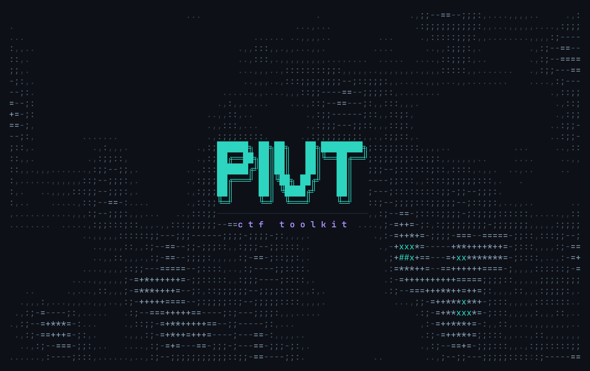
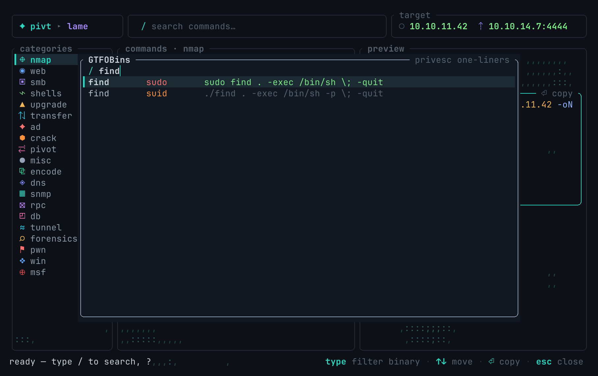

# pivt


A sleek TUI cheatsheet for CTF / pentest commands (Rust + ratatui).

118 bundled commands across 20 categories, filled from your target variables
and copied with one key. Run them live in a real PTY, parse scans into
suggestions, track loot and flags per room, and export a writeup.


| | |
|---|---|
|  |  |
|  | |

## Install

```sh
cargo install --git https://github.com/Th7bo/pivt
```

Or grab a prebuilt Linux x86_64 binary from
[Releases](https://github.com/Th7bo/pivt/releases).

Runtime requirements (Linux):

- A clipboard tool: **`wl-copy`** (Wayland), or **`xclip`** / **`xsel`** (X11). Without one (e.g. over SSH) pivt falls back to OSC 52, which most terminals honor.
- **`ip`** (iproute2) to auto-detect `LHOST` from tun/tap/wg/tailscale/wlan.
- A truecolor terminal and a font with good Unicode coverage
  (e.g. JetBrains Mono / any Nerd Font).

Run `pivt`, press `?` for keybinds. Add your own commands in
`~/.config/pivt/commands.toml` (same `[[command]]` schema as the bundled
`src/default_commands.toml`).

Screenshots are rendered headlessly:
`PIVT_SNAP_ANSI=1 pivt snap normal > s.txt && python3 scripts/ansi2png.py s.txt s.png`.
`snap` never reads or writes the saved session.

## Sessions

Close pivt and reopen it tomorrow: the workspace comes back. That covers the
active room, the selected category and command, the focused pane, the run
pane's visibility and zoom, the last parsed scan's ✸ suggestions, and every
run tab (up to 12, last 2000 lines of output each). Processes don't survive a
restart, so tabs come back dead and marked `restored · exited` or
`restored · was running`. Press `r` in the run pane to run that tab's command
again in its original directory. `r` also re-runs any finished tab.

The session is saved every ~30s, on changes and on quit. With a room active
it lives in `<room>/.pivt/session.toml` plus `<room>/.pivt/scrollback/`,
otherwise in `~/.config/pivt/session/`. Started from outside any room, pivt
returns to the last active room. `pivt --fresh` starts clean (the old session
is overwritten on the next save). An unreadable or other-version session file
is ignored with a status message.

## Job logs

Every job started from pivt (`x`, recipes, re-runs, cracks) also writes its
full output to `<room>/logs/<YYYYmmdd-HHMMSS>-<name>.log` (no room:
`~/.local/share/pivt/logs/`), colors kept, progress-bar redraws collapsed.
Read them with `less -R`. The command log links each run to its output, and
`E` lists them all in the exported writeup. Logs and other files holding
credentials are created `0600`. `PIVT_NO_LOG=1` turns logging off.

## Hack The Box (`H`)

Pulls the box straight from HTB Labs: name, OS, difficulty, IP, synopsis and
your user/root status, plus **Guided Mode** tasks with their questions,
answer format and hints (hidden until you press `h`; hints don't cost points).

- `⏎` answer the selected task or submit a user/root flag. Accepted flags fire
  the PWNED burst and go into the room's notes, like `F`. Solved guided
  answers are logged to the writeup.
- `m` load a machine by name; otherwise pivt loads your active machine (or the
  active room's name).
- `s` / `t` spawn / stop the machine. Once it has an IP, `RHOST` follows it.
- `r` refresh. The Discord presence shows `HTB <box> · <difficulty> · n/m tasks`.

Setup: Labs → avatar → Account Settings → **App Tokens** → create one, then

```sh
printf '%s' 'TOKEN' > ~/.config/pivt/htb_token && chmod 600 ~/.config/pivt/htb_token
```

(or export `HTB_TOKEN`). pivt uses the same endpoints as the HTB web app.

## Recipes (`R`)

Bundles of commands that run together, one run tab each. After a scan, press
`P` to parse it; recipes whose ports/services match the box float to the top
(●). `⏎` runs the selected recipe, `A` runs every matched one. Steps
with unset variables are skipped and listed in the status line.

A recipe with `sequential = true` runs its steps one at a time: the next
starts when the previous job exits, and `K` on the running step drops the
rest. Parallel nmaps over a VPN drop packets and miss ports, so the bundled
"first look" scan recipe is sequential. All sequential steps share one queue,
so stacking recipes with `A` never runs two of them at once.

Bundled: first look, web recon, smb enum, ad recon, dns, snmp, ad with creds.
Add or override your own in `~/.config/pivt/recipes.toml`:

```toml
[[recipe]]
name = "ftp"
description = "anon login check + banner"
ports = [21]
services = ["ftp"]
steps = ["misc/my ftp check"]   # "category/command name"
sequential = false              # true = one step at a time
```

## Cracking loot (`L` → `c`)

Hashes in the loot view are identified offline (NTLM / secretsdump lines,
NetNTLMv1/v2, kerberoast, AS-REP, DCC2, shadow `$6$`/`$5$`/`$1$`/`$y$`, bcrypt,
phpass, Django, MySQL, zip/7z/rar/KeePass/Office/PDF/SSH keys, raw MD5/SHA*).
`c` cracks the selected one in a run tab with **hashcat** (or **john jumbo**
if hashcat isn't installed) against `WORDLIST` (default rockyou). When it
finishes, the plaintext is saved to the entry and loaded into `PASS`.

## Discord Rich Presence

pivt can advertise what you're working on to Discord via Rich Presence:

- **details** — the active room name + flags captured (e.g. `DC-1 · 3 flags`),
  or `browsing commands` when no room is active.
- **state** — the current target with reachability and the box timer
  (e.g. `◎ 10.10.11.42 up · ⏱ 12:34`).
- an **elapsed timer** driven by the box start time.
- a large image asset keyed `pivt` with the text `pivt — ctf toolkit`.

It is **opt-in** and a silent no-op when Discord isn't running — the connection
lives on a background thread and never blocks or crashes the UI.

### Enabling it

Press **`D`** (Shift-D) in Normal mode, or set it in `~/.config/pivt/config.toml`:

```toml
discord_rpc = true
```

The setting is persisted. pivt ships with its own Discord application
(**pivt**, id `1574922609542303924`, art asset `pivt`), so nothing else is needed.

To use your own application instead, create one at
<https://discord.com/developers/applications>, upload an art asset named
**`pivt`** under **Rich Presence → Art Assets** (`assets/icon-p-square@2x.png`
works), and set its Application ID:

```toml
discord_app_id = "123456789012345678"
```

The activity shows as **Competing in pivt**. Both text lines rotate about every
15s through whatever has something to say: room + flags, running jobs, looted
creds, current category (top), and target status, open ports (bottom).

Buttons (Discord hides your own buttons from you; others see them):

- **view room** links `https://tryhackme.com/room/<active room>` when a room is active.
- **get pivt** links the repo (override with `discord_link = "https://…"`).

The small corner badge shows the current category's glyph in its TUI colour,
loaded from `assets/presence/<category>.png` in this repo (no Discord upload
needed). Regenerate after adding a category to `theme.rs`:

```sh
python3 scripts/presence_icons.py src/theme.rs assets/presence
```

The presence refreshes about every 5 seconds while pivt runs.

## License

MIT, see [LICENSE](LICENSE).
