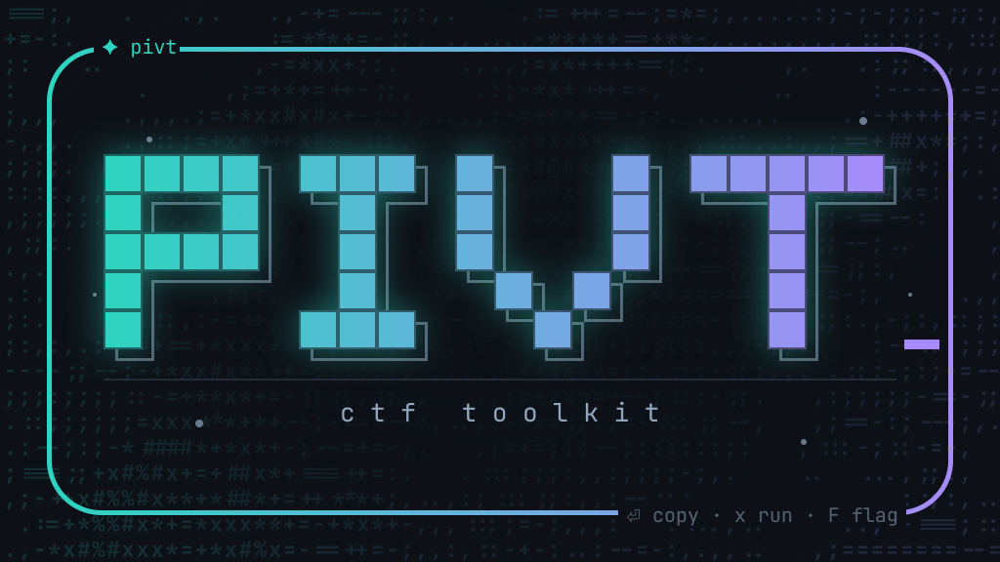

# pivt



A sleek TUI cheatsheet for CTF / pentest commands (Rust + ratatui).

## Discord Rich Presence

pivt can advertise what you're working on to Discord via Rich Presence:

- **details** — the active room name + flags captured (e.g. `DC-1 · 3 flags`),
  or `browsing commands` when no room is active.
- **state** — the current target with reachability and the box timer
  (e.g. `◎ 10.10.11.42 up · ⏱ 12:34`).
- an **elapsed timer** driven by the box start time.
- a large image asset keyed `pivt` with the text `pivt — ctf toolkit`.

It is **opt-in** and a silent no-op when Discord isn't running — the connection
lives on a background thread and never blocks or crashes the UI.

### Enabling it

Press **`D`** (Shift-D) in Normal mode, or set it in `~/.config/pivt/config.toml`:

```toml
discord_rpc = true
```

The setting is persisted. pivt ships with its own Discord application
(**pivt**, id `1574922609542303924`, art asset `pivt`), so nothing else is needed.

To use your own application instead, create one at
<https://discord.com/developers/applications>, upload an art asset named
**`pivt`** under **Rich Presence → Art Assets** (`assets/icon-p-square@2x.png`
works), and set its Application ID:

```toml
discord_app_id = "123456789012345678"
```

The activity shows as **Competing in pivt**. Both text lines rotate about every
15s through whatever has something to say: room + flags, running jobs, looted
creds, current category (top), and target status, open ports (bottom).

Buttons (Discord hides your own buttons from you; others see them):

- **view room** links `https://tryhackme.com/room/<active room>` when a room is active.
- **get pivt** links the repo (override with `discord_link = "https://…"`).

The small corner badge shows the current category's glyph in its TUI colour,
loaded from `assets/presence/<category>.png` in this repo (no Discord upload
needed). Regenerate after adding a category to `theme.rs`:

```sh
python3 scripts/presence_icons.py src/theme.rs assets/presence
```

The presence refreshes about every 5 seconds while pivt runs.
