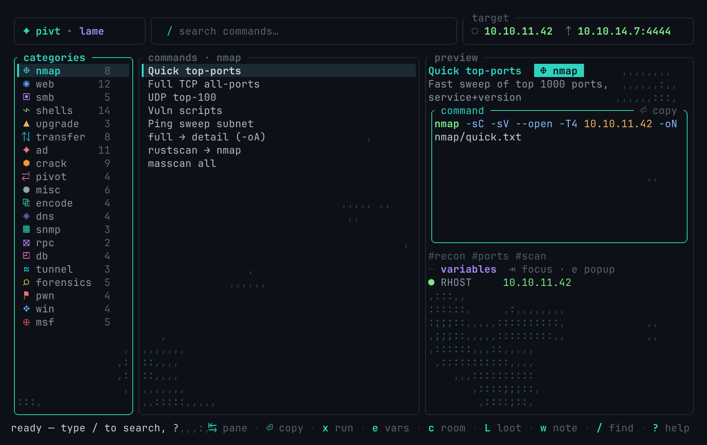
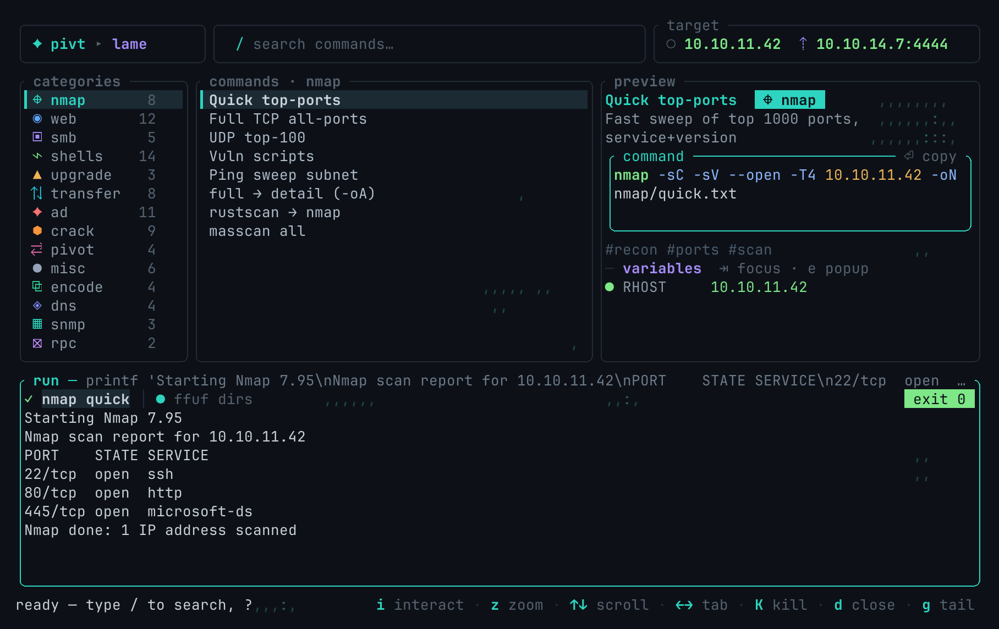

# pivt


A sleek TUI cheatsheet for CTF / pentest commands (Rust + ratatui).

118 bundled commands across 20 categories, filled from your target variables
and copied with one key. Run them live in a real PTY, parse scans into
suggestions, track loot and flags per room, and export a writeup.



| | |
|---|---|
|  |  |
|  | |

## Install

```sh
cargo install --git https://github.com/Th7bo/pivt
```

Or grab a prebuilt Linux x86_64 binary from
[Releases](https://github.com/Th7bo/pivt/releases).

Runtime requirements (Linux):

- A clipboard tool: **`wl-copy`** (Wayland), or **`xclip`** / **`xsel`** (X11). Without one (e.g. over SSH) pivt falls back to OSC 52, which most terminals honor.
- **`ip`** (iproute2) to auto-detect `LHOST` from tun/tap/wg/tailscale/wlan.
- A truecolor terminal and a font with good Unicode coverage
  (e.g. JetBrains Mono / any Nerd Font).

Run `pivt`, press `?` for keybinds ([remappable](#keybindings)). Add your own commands in
`~/.config/pivt/commands.toml` (same `[[command]]` schema as the bundled
`src/default_commands.toml`).

Screenshots are rendered headlessly:
`PIVT_SNAP_ANSI=1 pivt snap normal > s.txt && python3 scripts/ansi2png.py s.txt s.png`.
`snap` never reads or writes the saved session. Add `--theme <name>` (or set
`PIVT_THEME=<name>`) to render any theme, e.g. `pivt snap normal --theme nord`.

## Keybindings

Every main-view action can be remapped in `~/.config/pivt/config.toml`.
The defaults below are the built-in layout (picked to work on AZERTY too);
only list what you want to change:

```toml
[keys]
run = "x"
zoom = "z"
history = ["y", "ctrl-r"]   # several keys: a list
detach = ["f12", "ctrl-]"]
help = "f1"
```

Key syntax: a single character (case-sensitive: `L` ≠ `l`), optionally with
`ctrl-`, `alt-` or `shift-` (`ctrl-r`, `alt-x`, `shift-tab`), or a named key:
`f1`…`f12`, `enter`, `esc`, `tab`, `space`, `up` / `down` / `left` / `right`,
`pgup` / `pgdn`, `home` / `end`, `delete`, `backspace`. Action names accept
`-` for `_`. Setting an action replaces its default keys; `[]` unbinds it.

`pivt keys` prints the effective map and any problems. The help overlay
(`?`) and the footer always show the keys actually bound.

**Rules.** An unknown action, a key that doesn't parse or a value of the
wrong type is skipped with a warning in the status line at startup; the rest
of the config still loads. A key bound to two actions in the same context is
a conflict: a binding you wrote beats a default, and between two of yours
the action listed first in the table below wins (both cases warn, a lost
default only when it leaves that action with no key). The run-pane keys
shadow the main-view ones only while the run pane is focused, so `d` meaning
close there and delete elsewhere is not a conflict; keys the run pane doesn't
bind fall through. `ctrl-c` is reserved: it always quits (asking first while
jobs run) and is sent to the program while interacting. `help` falls back to
`?` and `detach` to `f12` / `ctrl-]` if they end up with no key, so you can't
lock yourself out. `Esc` (back / unzoom / clear search / quit) and the keys
inside overlays (lists, prompts, text fields) are fixed.

Main view:

| action | default | does |
|---|---|---|
| `up` / `down` | `up` `k` / `down` `j` | move within a pane |
| `focus_next` / `focus_prev` | `tab` `l` `right` / `shift-tab` `h` `left` | switch pane |
| `copy` | `enter` | fill + copy (preview pane: edit the variable) |
| `run` | `x` | run the command live |
| `run_pane` | `` ` `` | show / hide the run pane |
| `quit` | `q` | quit (`Esc` too, `ctrl-c` always) |
| `vars` | `e` | variables editor |
| `add` / `delete` | `a` / `d` | add / delete a user command |
| `search` | `/` | fuzzy search |
| `help` | `?` | help overlay |
| `rooms` | `c` | rooms |
| `note` | `w` | writeup note |
| `notes` | `o` | open room notes in `$EDITOR` |
| `loot` | `L` | loot / creds |
| `favorite` | `f` | pin / unpin favorite |
| `bg` | `b` | cycle background: stars / flow / matrix / snow / plasma / off ([animations](#animations)) |
| `theme` / `theme_picker` | `t` / `T` | next theme / theme picker |
| `settings` | `,` | [settings screen](#settings-) |
| `discord` / `discord_privacy` | `D` / `M` | Discord presence on/off / privacy |
| `gtfobins` | `g` | GTFOBins lookup |
| `parse` | `P` | parse scan output |
| `recipes` | `R` | recipes |
| `htb` | `H` | Hack The Box panel |
| `flag` | `F` | capture a flag |
| `export` | `E` | export writeup |
| `missing` | `m` | rescan PATH + hide/show missing tools |
| `history` | `y` `ctrl-r` | command history |
| `scope` | `S` | room scope editor |

Run pane focused:

| action | default | does |
|---|---|---|
| `scroll_down` / `scroll_up` | `down` `j` / `up` `k` | scroll output |
| `page_down` / `page_up` | `pgdn` / `pgup` | scroll a page |
| `tab_prev` / `tab_next` | `left` `[` / `right` `]` | switch run tab |
| `kill` | `K` | kill the job |
| `close` | `d` | close the tab |
| `rerun` | `r` | re-run the tab |
| `tail` | `g` | jump to the end |
| `zoom` | `z` | zoom fullscreen |
| `interact` | `i` `enter` | type into the program |

Interacting with a job:

| action | default | does |
|---|---|---|
| `detach` | `f12` `ctrl-]` | stop typing into the program |

Inside an overlay, the key that opened it closes it again for help, the theme
picker and scope (and the theme key steps through themes in the picker); for
history only non-letter keys (`ctrl-r`, F-keys) do, so letters stay free.

## Missing tools

pivt checks `PATH` (plus `~/.local/bin`, where distrobox exports its
wrappers) once at startup and marks commands whose program isn't installed
with a dim name and `✗`. The preview says which one and how to get it, e.g.
`✗ wpscan not installed — gem install wpscan · kali: apt install wpscan`
(Fedora `dnf` packages, the Kali `apt` name for a kali distrobox, or a
`pipx` / `cargo` / `gem` install). `x` and recipes refuse such a command with
a status message instead of starting a job that dies with exit 127.

`m` rescans `PATH` (so a tool you just installed counts) and toggles hiding
those commands (saved as `hide_missing`). Target-side (`◎`) commands run on
the victim and are never marked.

The program is guessed from the template: the first word of each pipeline /
`;` / `&&` segment, skipping `sudo`, `env`, `VAR=val` prefixes, redirections
and shell builtins, looking inside `sh -c '…'` and expanding `$HOME` / `~`.
Anything built at run time (`$VAR`, `$(…)`, `<PLACEHOLDER>`, relative paths)
isn't guessed. Override the guess per command:

```toml
[[command]]
category = "ad"
name = "secretsdump (venv)"
template = "python3 ~/tools/impacket/secretsdump.py <DOMAIN>/<USER>:<PASS>@<RHOST>"
requires = ["impacket-secretsdump"]
```

## Themes

`t` cycles themes and `T` opens a picker with a live preview (`↑↓` preview,
`⏎` keep, `esc` revert, `r` reload theme files). The choice is saved in
`config.toml` as `theme = "<name>"`; an unknown name falls back to the
default instead of breaking the config. `--theme <name>` / `PIVT_THEME`
override it for one run without saving.

Presets: **pivt** (default), **catppuccin mocha**, **gruvbox dark**,
**tokyo night**, **nord** and **rosé pine**, using each project's published
palette. Names match loosely: `rose-pine`, `catppuccin`, `tokyo_night` work.

### Custom themes

Drop a TOML file into `~/.config/pivt/themes/` (one theme per file). Give it a
`name` (defaults to the file name) and any subset of colour roles as hex
strings; everything you leave out is inherited from `base` (default: `pivt`).
Bad colours and unknown keys are skipped, and a file can't reuse a preset's
name.

```toml
# ~/.config/pivt/themes/dracula.toml
name = "dracula"
base = "pivt"            # optional: inherit from any preset or theme

bg = "#282a36"           # screen background
panel = "#21222c"        # popups / overlays
fg = "#f8f8f2"           # main text
subtle = "#e2e2dc"       # unselected list rows
muted = "#bfbfbf"        # descriptions
dim = "#6272a4"          # hints, labels
accent = "#bd93f9"       # focus, keys, banner (border_hi follows it)
accent2 = "#ff79c6"      # headings, subtitle
accent_hi = "#f8f8f2"    # bright end of the pulsing accent
warn = "#ff5555"         # errors, unset <PLACEHOLDERS>
ok = "#50fa7b"           # success, set values
border = "#44475a"
border_hi = "#bd93f9"    # focused borders
sel_bg = "#44475a"       # selected row
star_faint = "#2f3140"   # background starfield / flow field, faint → bright
star_dim = "#3a3c4e"
star_mid = "#4d5066"
star_hi = "#6272a4"
syn_flag = "#8be9fd"     # command preview: -flags
syn_str = "#f1fa8c"      #   'strings'
syn_num = "#ffb86c"      #   numbers / IPs / ports
syn_op = "#6272a4"       #   | ; && > <
gold = "#f1fa8c"         # favourite stars
orange = "#ffb86c"       # hashes, SUID
slate = "#6272a4"        # GTFOBins frame
htb = "#50fa7b"          # Hack The Box panel

[categories]             # optional, per category
nmap = "#8be9fd"
web = "#bd93f9"
```

Categories: `nmap web smb shells upgrade transfer ad crack pivot misc encode
dns snmp rpc db tunnel forensics pwn win msf favorites recent suggested`.

## Layout

Pane sizes, which panes and header items show, and a compact mode for small
terminals, all under `[layout]` in `config.toml`. List only what you change;
`pivt prefs` prints every option with its current value (`*` = changed) and
any problems. Bad values never break the config: an unknown key, a wrong
type or an unknown choice is ignored with a warning in the status line at
startup, and numbers out of range are clamped.

```toml
[layout]
categories_width = 16    # columns
commands_width = 50      # % of the width; the preview takes the rest
show_preview = false
compact = true
```

| key | default | values | |
|---|---|---|---|
| `categories_width` | `20` | 10–40 columns | categories pane width |
| `commands_width` | `42` | 20–80 % | commands pane width; preview gets the rest |
| `run_height` | `42` | 15–85 % | run pane height when split (`z` zoom is unchanged) |
| `show_categories` | `true` | bool | categories pane (hidden: browse with `/` search) |
| `show_preview` | `true` | bool | preview pane (the commands pane is always shown) |
| `show_logo` | `true` | bool | header: logo + active room |
| `show_search` | `true` | bool | header: search box (`/` still works) |
| `show_target` | `true` | bool | header: target box |
| `show_ping` | `true` | bool | target box: reachability dot |
| `show_timer` | `true` | bool | target box: box timer + rtt |
| `show_scope` | `true` | bool | target box: `⊙ scope` badge + `✓`/`⚠` mark |
| `show_lhost` | `true` | bool | target box: `⇡ LHOST:LPORT` |
| `show_hints` | `true` | bool | key hints in the footer (main view; popups keep theirs, the status line stays) |
| `compact` | `false` | bool | no pane borders, one-line header |

Hidden panes give their space to the others and drop out of the `⇥` cycle.
On small terminals the layout degrades instead of breaking: the preview
always keeps ~30 columns while it can, a pane that can't fit (categories
below ~22 columns, preview below 14) is dropped, the run pane keeps 6 rows of
panes above it, and the header goes away when there are fewer than ~7 rows.

## Look & motion

Background, splash, animations, borders and glyphs live under `[look]`, with
the same lenient rules as `[layout]`.

```toml
[look]
background = "flow"
flow_charset = "blocks"
animations = false
border = "plain"
marker = "arrow"

[look.categories]        # per category: glyph and/or colour
web = { glyph = "W", color = "#7aa2f7" }
loot = { color = "accent2" }   # your own categories too
nmap = "N"                     # shorthand: glyph only
```

| key | default | values | |
|---|---|---|---|
| `splash` | `true` | bool | startup splash (`PIVT_NO_SPLASH=1` / `--no-splash` still skip it) |
| `splash_hold` | `true` | bool | wait for a key; `false` = continue after `splash_seconds` |
| `splash_seconds` | `3` | 1–30 | auto-continue delay |
| `border` | `"rounded"` | `rounded` `plain` `double` `thick` `none` | border style (`none`: panes lose their borders, popups draw plain lines) |
| `marker` | `"bar"` | `bar` `▎` · `arrow` `▸` · `dot` `•` · `chevron` `›`, or any one single-width character | selected-row marker |

The background, motion and splash options are listed under
[Animations](#animations).

`[look.categories]` overrides the theme's category colour and the built-in
glyph, by category name. A colour is `#rrggbb` / `#rgb` or a theme role name
(`accent`, `accent2`, `ok`, `warn`, `gold`, `orange`, …, see
[custom themes](#custom-themes)), so role colours follow theme switches.

`pivt snap <view> --size 80x24` (or `PIVT_SNAP_SIZE=80x24`) renders any of
this headlessly at a given size.

## Animations

Everything that moves is tunable, all under `[look]` (same lenient rules:
unknown keys and bad values are skipped with a warning, numbers out of range
are clamped, and only what you set is written back). In the settings screen
(`,`) they're in the **Background** and **Animations** sections.

```toml
[look]
background = "matrix"     # stars · flow · matrix · snow · plasma · off
fps = 30
matrix_charset = "binary"
star_parallax = true
shoot_angle = "random"
burst_style = "confetti"
burst_text = "{which} on {BOX} 🏁"
splash_banner = "file"
splash_file = "~/.config/pivt/splash.txt"
splash_reveal = "scanline"
splash_bg = "plasma"
```

**Global.** `animations = false` is the master switch and beats every option
below: everything stands still (steady accent, frozen background, finished
splash, no burst animation) and pivt stops repainting every frame; it
redraws on input, on new job output, when the ping state changes, and once a
second for the box timer. Handy on slow SSH links or if motion is
distracting.

| key | default | values | |
|---|---|---|---|
| `animations` | `true` | bool | master switch (see above) |
| `fps` | `20` | 5–60 | frame rate cap. Timers, job polling, session saves, presence and the ping are on wall-clock time, so they keep their pace at any rate |

**Background.** Drawn under the UI: only empty cells show it, and the
in-app versions are kept faint so text stays readable (the splash uses a
louder version of the same effect). The mouse is captured only for the flow
ripple (and the run pane), so text selection keeps working otherwise.

| key | default | values | |
|---|---|---|---|
| `background` | `"stars"` | `stars` `flow` `matrix` `snow` `plasma` `off` | effect behind the UI; `b` cycles it and saves it here (the old `flow_bg = true` still means flow when this isn't set) |
| `bg_density` | `5` | 1–10 | starfield / flow density |
| `bg_slowdown` | `1` | 1–10 | background clock divisor: 2 = half speed |
| `star_glyphs` | `"classic"` | `classic` · `dots` `·∙•●` · `ascii` `.+*` · `sparkle` `·✧✦`, or your own (1–12 chars, dim → bright) | starfield glyphs |
| `star_twinkle` | `5` | 1–10 | twinkle rate |
| `star_twinklers` | `12` | 0–100 % | share of stars that twinkle (the splash: twice that) |
| `star_drift` | `"up"` | `up` `down` `left` `right` `none` | drift direction (in-app; the splash field holds still) |
| `star_speed` | `5` | 1–10 | drift speed (5 ≈ one row per 0.8 s) |
| `star_brightness` | `5` | 1–10 | darker toward the background / brighter toward the theme's brightest star colour |
| `star_parallax` | `false` | bool | three depth layers: far (dense, slow, dim) to near (sparse, fast, bright) |
| `star_color` | `"theme"` | `theme` `accent` `category` | theme star ramp, tinted toward the accent, or toward the selected category's hue |
| `flow_charset` | `"classic"` | `classic` ` .,:;-=+*x#%@` · `blocks` `░▒▓█` · `dots` `·•●` · `ascii` (a 68-char ramp) · `braille` `⠁⠃⠇⡇⣇⣧⣷⣿`, or your own string (2–96 single-width chars, faint → dense) | flow field ramp |
| `flow_scale` | `5` | 1–10 | zoom: higher = bigger swirls |
| `flow_speed` | `5` | 0–10 | 0 = frozen |
| `flow_angle` | `203` | 0–359 ° (`←`/`→` step 15) | drift heading, 0 = right, 90 = up (203 is the original left-and-a-bit-down) |
| `flow_octaves` | `3` | 1–5 | turbulence (fbm noise octaves) |
| `flow_wave` | `3` | 0–10 | amplitude of the slow transverse wave |
| `flow_contrast` | `5` | 1–10 | contrast |
| `flow_cutoff` | `5` | 0–10 | higher = more blank cells |
| `flow_color` | `"category"` | `theme` `category` `rainbow` | theme ramp, tinted toward the selected category, or cycling through the theme's category hues over time |
| `ripple` | `true` | bool | mouse ripple in the flow field (off also releases the mouse unless the run pane is open) |
| `ripple_strength` | `5` | 0–10 | |
| `ripple_radius` | `5` | 1–10 | |
| `ripple_speed` | `5` | 1–10 | |
| `matrix_charset` | `"katakana"` | `katakana` (half-width) `ascii` `binary` `hex` | matrix rain glyphs |
| `matrix_speed` | `5` | 1–10 | fall speed |
| `matrix_density` | `5` | 1–10 | how many columns rain |
| `snow_density` | `5` | 1–10 | flakes (two depth layers) |
| `snow_speed` | `5` | 1–10 | fall speed |
| `snow_wind` | `1` | -5–5 | negative blows left |
| `plasma_charset` | `"classic"` | the `flow_charset` presets, or your own | plasma ramp |
| `plasma_scale` | `5` | 1–10 | zoom: higher = bigger blobs |
| `plasma_speed` | `5` | 1–10 | |
| `plasma_density` | `5` | 1–10 | how much of the field shows (in-app only the crests) |

**Effects.**

| key | default | values | |
|---|---|---|---|
| `shoot` | `true` | bool | shooting stars over the starfield |
| `shoot_every` | `13` | 2–120 s | time between streaks (the splash: a sixth of it) |
| `shoot_angle` | `"right"` | `right` `left` `down-right` `down-left` `up-right` `up-left` `down` `random` | heading (`random` picks one per streak) |
| `shoot_length` | `4` | 2–20 cells | trail length |
| `shoot_speed` | `5` | 1–10 | 5 crosses the screen in about half a second |
| `shoot_trail` | `"classic"` | `classic` `✦━─·` · `dots` `●•·.` · `sparkle` `✦✧*·` · `ascii` `*=-.` · `comet` `✦✧⋆∙·`, or your own (1–12 chars, head first) | trail glyphs, stretched over the length |
| `shoot_color` | `"auto"` | `auto` or a theme role: `accent` `accent2` `accent_hi` `ok` `warn` `gold` `orange` `fg` `star_hi` `star_mid` `border_hi` `htb` | head colour, the trail fades from it (`auto`: the original star colours) |
| `pulse` | `true` | bool | the selected-row marker pulses (off = steady `pulse_from`) |
| `pulse_speed` | `5` | 1–10 | 5 = one beat per 0.6 s |
| `pulse_from` | `"accent"` | a theme role (as above, without `auto`) | resting colour |
| `pulse_to` | `"accent_hi"` | a theme role | peak colour |
| `burst` | `true` | bool | the flag-capture celebration (off = no animation, no banner) |
| `burst_style` | `"ring"` | `ring` `sparkle` `confetti` | shockwave ring, a sparkle explosion, or falling confetti in the theme's category colours |
| `burst_ms` | `1500` | 300–10000 ms (`←`/`→` step 100) | how long it lasts |
| `burst_text` | `"{WHICH} PWNED"` | text, up to 40 chars | banner: `{WHICH}` / `{which}` (USER / user, ROOT / root), `{BOX}` (RHOST), `{ROOM}`, `{N}` (flags captured); or just your own words |
| `burst_flash` | `true` | bool | the banner flashes |

**Splash.** (`splash`, `splash_hold` and `splash_seconds` are in
[Look](#look--motion); these take effect at the next start.)

| key | default | values | |
|---|---|---|---|
| `splash_banner` | `"pivt"` | `pivt` `file` `text` | the built-in PIVT art, `splash_file`, or `splash_text` |
| `splash_file` | `""` | path (`~/` ok) | ASCII art file: up to 120 rows × 400 columns are kept, tabs become 4 spaces, ANSI colour codes are dropped, and it's clipped to the terminal. Missing or empty → the built-in banner and a startup warning |
| `splash_text` | `""` | up to 16 chars | your own banner text |
| `splash_font` | `"block"` | `block` `plain` | `splash_text` in a built-in 5-row block font (A–Z, 0–9, `- ! ? . _ : / +`), or as one letter-spaced line |
| `splash_subtitle` | `"ctf toolkit"` | up to 40 chars, empty = none | letter-spaced when it fits |
| `splash_reveal` | `"typewriter"` | `typewriter` `fade` `scanline` `instant` | left to right with a glowing edge, cells fading in at random, rows top to bottom, or all at once |
| `splash_reveal_speed` | `5` | 1–10 | 5 = 0.75 s |
| `splash_bg` | `"same"` | `same` `stars` `flow` `matrix` `snow` `plasma` `off` | background behind the splash (`same` = `background`) |

A custom splash file is plain text, drawn centred in the accent colour.
Save this as `~/.config/pivt/splash.txt` and set `splash_banner = "file"`,
`splash_file = "~/.config/pivt/splash.txt"`:

```text
    ____  _       ___   __
   / __ \| |     / / | / /
  / /_/ /| | /| / /  |/ /
 / ____/ | |/ |/ / /|  /
/_/      |__/|__/_/ |_/
```

**Screenshots and timing.** `pivt snap bg:<stars|flow|matrix|snow|plasma|off>`
renders the main view over a background, `pivt snap burst:<ring|sparkle|confetti>`
a flag burst, `pivt snap splash:<N>` the splash N × 50 ms in. `--set key=value`
(repeatable) applies options for that one render without saving them, e.g.
`pivt snap splash:40 --set splash_banner=text --set splash_text=htb --set splash_bg=matrix`.
`pivt snap bench[:<background>] --size 200x60` prints the average time per
frame for each background with the whole UI on top (a few ms at 200x60 in a
release build: no per-cell allocation, palettes resolved once per frame).

## Settings (`,`)

`,` opens one screen with every setting, so you never have to hand-edit
`config.toml`: sections down the left (General · Look · Background ·
Animations · Layout ·
Theme · Discord & privacy · Scope & safety · Paths & integration ·
Keybindings), the options of the selected one on the right with their
current value, whether you set it (`● set`) or it's the default, and a short
description; the detail line below shows the range or choices and the
default. `/` filters every option by name or description.

| on a… | keys |
|---|---|
| on/off option | `⏎` / `space` toggle · `←` off · `→` on |
| number | `←` / `→` step · `⏎` type an exact value |
| choice | `←` / `→` / `⏎` cycle |
| glyph set | `←` / `→` cycle the presets · `⏎` type your own |
| path / text | `⏎` edit inline (`^u` clears) |
| theme | `↑` / `↓` preview live · `⏎` keep (leaving reverts the preview) |
| any row | `r` back to the default |

Everything applies live (layout, theme, background, borders redraw at once)
and is saved straight away. Only what you change is written: `r` removes
the key from `config.toml` rather than writing the default. Typed values are
validated like the config file; an invalid one turns red and isn't saved
(numbers out of range are refused, not clamped). The splash options take
effect at the next start, and `rooms_dir` says so when `$CTF_ROOT` overrides
it. `Esc` goes back to the sections, then closes; `,` closes too.

**Keybindings.** Every action is listed with its keys. `⏎` waits for a key
and *adds* it to the action, `c` waits for one and *replaces* all its keys,
`⌫` removes the last key, `r` restores the defaults (removing the `[keys]`
entry). While waiting, `Esc` cancels and `⌫` removes. The [usual
rules](#keybindings) apply: a key you bind beats a default (the action that
had it is shown with `⚠ x is taken by …`), between two of your bindings the
action listed first keeps it (you're told), `ctrl-c` is refused, and `help`,
`detach` and `settings` always keep at least one key. A list that ends up
equal to the defaults is dropped from `[keys]`.

`pivt snap settings` (or `settings:keys`, `settings:look`, `settings:theme`,
…, `settings:/<filter>`, `settings:capture`, `settings:edit`) renders it
headlessly.

## Rooms and shell integration

A room is a directory with a `.ctfroom` marker, holding `nmap/ loot/
exploits/`, `notes.md`, the command log and job logs. `c` lists and activates
rooms, `n` scaffolds one, `p` marks the highlighted room as a THM room or HTB
machine (see [Discord](#discord-rich-presence)), `s` edits its
[scope](#scope-s). Starting pivt inside a room activates it.

Where rooms live, first match wins:

1. `$CTF_ROOT`
2. `rooms_dir` in `~/.config/pivt/config.toml` (`~` is expanded)
3. `~/TryHackMe`, if that directory already exists (the old default)
4. `$XDG_DATA_HOME/pivt/rooms` (`~/.local/share/pivt/rooms`)

Other settings in `config.toml`:

```toml
# copied into every new room (unset: ~/.config/zsh/ctf-cheatsheet.md if it
# exists, as CHEATSHEET.md; "" = copy nothing)
room_template = "~/notes/room-template.md"

# mirror RHOST into a file whenever it changes, and read it at startup when
# no room target is set (unset: ~/.cache/ctf-target, only if that file
# already exists; "" = off)
sync_target_file = "~/.cache/ctf-target"
```

`sync_target_file` is a hook for shell functions: the file holds the bare
target IP plus a newline, so a shell can share pivt's target, e.g.

```sh
target() { [ -n "$1" ] && echo "$1" > ~/.cache/ctf-target; cat ~/.cache/ctf-target; }
export TARGET=$(cat ~/.cache/ctf-target 2>/dev/null)
```

Each room also gets a `.target` file (`<ip> [host]`) with the same contents.

## Scope (`S`)

Each room has a scope: the hosts its commands are allowed to touch. Before
anything runs (`x`, recipe and sequence steps, `r` in the run pane, `x` in
the history), pivt reads the hosts out of the **filled** command line and
checks them against the active room's scope, so a stale `RHOST` from the
last box, a typo, or a real host on your own network doesn't get scanned by
accident.

What counts as a host: IPv4 addresses and CIDRs (`10.10.10.0/24`, an nmap
range like `10.10.10.1-254` by its base), IPv6, URL hosts
(`http://dev.box.htb:8080/…`; only the authority, not a path or an SSRF
payload in it), `user@host`, `domain/user:pass@host`, `@dns-server`,
`//host/share`, `host.tld:port`, bare dotted names with a known TLD
(`box.htb`, `dc01.corp.local`), and the values of `RHOST`, `DOMAIN`, `URL`,
`HOST`, `VHOST`, `DC`… whenever they appear in the line. Versions like
`7.0.0` or `2.4.10`, file names (`rockyou.txt`, `http.server`), `-p 7744`
and passwords containing `@` are not hosts.

Always allowed: `LHOST`, this machine's interface addresses, loopback,
`localhost`, `0.0.0.0`, and a few public reference sites (GitHub, PyPI,
HTB/THM). A command with no target at all (listeners, `http.server`) always
passes. Without an active room nothing is checked.

**Defaults** (zero config): a room with no explicit scope is scoped to its
`.target` IP and hostname (plus `*.hostname` for vhosts), and to the HTB
machine's IP when the room is that machine. A hostname also counts when
`/etc/hosts` maps it onto an in-scope address. Activating a room that has no
`.target` doesn't adopt the previous room's `RHOST`: it is flagged until you
set a target for the new room.

**When a host is outside the scope**, `scope_mode` in `config.toml` decides:

```toml
scope_mode = "confirm"   # default: ask · "warn": run, say so · "strict": refuse
```

`confirm` asks *"10.10.11.42 is outside this room's scope (192.168.56.102,
dc-2) — run anyway?"*: `y` runs it once (logged to the writeup), `a` adds the
host to the scope and runs, anything else cancels. One question covers a
whole recipe, and a yes carries over to its queued sequential steps. Copies
(`⏎`) are never blocked; the status line just warns. An unknown
`scope_mode` falls back to `confirm`.

The header shows `⊙ scope: N` on the target box and `✓` / `⚠` next to
`RHOST`. `S` (or `s` on a room in `c`) opens the scope editor: `a` adds
entries (several at once, space or comma separated), `d` removes one, `r`
goes back to the defaults, `m` cycles `scope_mode`. Entries are IPv4 / IPv6
addresses, CIDRs, hostnames and `*.domain` wildcards. Pinning a scope (the
first add or remove) starts from the current defaults, so the room's own
target stays in. The scope lives in the room's `.ctfroom` next to its
platform (the file is `0600`):

```toml
platform = "htb"
scope = ["192.168.56.102", "dc-2", "10.10.110.0/24", "*.corp.local"]
```

## Sessions

Close pivt and reopen it tomorrow: the workspace comes back. That covers the
active room, the selected category and command, the focused pane, the run
pane's visibility and zoom, the last parsed scan's ✸ suggestions, and every
run tab (up to 12, last 2000 lines of output each). Processes don't survive a
restart, so tabs come back dead and marked `restored · exited` or
`restored · was running`. Press `r` in the run pane to run that tab's command
again in its original directory. `r` also re-runs any finished tab.

The session is saved every ~30s, on changes and on quit. With a room active
it lives in `<room>/.pivt/session.toml` plus `<room>/.pivt/scrollback/`,
otherwise in `~/.config/pivt/session/`. Started from outside any room, pivt
returns to the last active room. `pivt --fresh` starts clean (the old session
is overwritten on the next save). An unreadable or other-version session file
is ignored with a status message.

## Job logs

Every job started from pivt (`x`, recipes, re-runs, cracks) also writes its
full output to `<room>/logs/<YYYYmmdd-HHMMSS>-<name>.log` (no room:
`~/.local/share/pivt/logs/`), colors kept, progress-bar redraws collapsed.
Read them with `less -R`. The command log links each run to its output, and
`E` lists them all in the exported writeup. Logs and other files holding
credentials are created `0600`. `PIVT_NO_LOG=1` turns logging off.

## History (`y` / `Ctrl-r`)

Every copy (`⏎`) and run (`x`, `r` in the run pane, recipe steps) is
recorded per room in `<room>/.pivt/history.jsonl` (no room:
`~/.config/pivt/session/history.jsonl`): time, command, the **filled**
command line, copy or run, and for runs the exit code and job log path.
The file is append-only JSON lines; an exit code is appended as its own
record when the job ends, and lines pivt can't read are skipped. Filled
commands can hold passwords, so it is `0600` in a `0700` directory.
`PIVT_NO_LOG=1` turns it off along with the other logs.

`y` (or `Ctrl-r`) opens it, newest first: time, copy/run, name, exit status
(`✓ 0`, `✗ 2`, `✗ killed`, `… running`). `/` filters (fuzzy), `⏎` copies the
filled command again, `x` re-runs it in a new tab (refused for target-side
commands, missing tools or lines that still hold a `<PLACEHOLDER>`), and `l`
opens its log in `$PAGER` (default `less -R`).

## Writeup export (`E`)

`E` builds `writeup.md` in the room (no room: `~/.config/pivt/writeups/`)
from the target info, the loot table, `notes.md`, a "Commands run" table from
the history (each run with its exit code), the command log and links to the
job logs. HTB forbids sharing solutions to active machines and THM's rules
forbid publishing flags or walkthroughs for active content, so pivt asks first:

- `n` / `⏎` (default): flags and credential values become `‹redacted›`, with
  the structure kept. That covers loot passwords and hashes, `PASS`/`HASH`/
  `*TOKEN*`/`*KEY*`/`*SECRET*` variable values wherever they appear (filled
  commands included), the values in the notes' Flags table, pivt's flag /
  task-answer / cracked log lines, `HTB{…}`/`THM{…}`/`flag{…}` tokens and bare
  32-hex strings. Linked job logs are raw files and are not redacted.
- `y`: include everything.

If the HTB panel has a machine loaded that isn't retired, the prompt warns
that the box is active, and the file is written as `writeup-PRIVATE.md` with a
"PRIVATE — active box" header.

## Hack The Box (`H`)

Pulls the box straight from HTB Labs: name, OS, difficulty, IP, synopsis and
your user/root status, plus **Guided Mode** tasks with their questions,
answer format and hints (hidden until you press `h`; hints don't cost points).

- `⏎` answer the selected task or submit a user/root flag. Accepted flags fire
  the PWNED burst and go into the room's notes, like `F`. Solved guided
  answers are logged to the writeup.
- `m` load a machine by name; otherwise pivt loads your active machine (or the
  active room's name).
- `s` / `t` spawn / stop the machine. Once it has an IP, `RHOST` follows it.
- `r` refresh. The Discord presence shows `HTB <box>` (`full` mode adds
  difficulty and `n/m tasks`).

Setup: Labs → avatar → Account Settings → **App Tokens** → create one, then

```sh
printf '%s' 'TOKEN' > ~/.config/pivt/htb_token && chmod 600 ~/.config/pivt/htb_token
```

(or export `HTB_TOKEN`). pivt uses the same endpoints as the HTB web app.

## Recipes (`R`)

Bundles of commands that run together, one run tab each. After a scan, press
`P` to parse it; recipes whose ports/services match the box float to the top
(●). `⏎` runs the selected recipe, `A` runs every matched one. Steps
with unset variables are skipped and listed in the status line.

A recipe with `sequential = true` runs its steps one at a time: the next
starts when the previous job exits, and `K` on the running step drops the
rest. Parallel nmaps over a VPN drop packets and miss ports, so the bundled
"first look" scan recipe is sequential. All sequential steps share one queue,
so stacking recipes with `A` never runs two of them at once.

Bundled: first look, web recon, smb enum, ad recon, dns, snmp, ad with creds.
Add or override your own in `~/.config/pivt/recipes.toml`:

```toml
[[recipe]]
name = "ftp"
description = "anon login check + banner"
ports = [21]
services = ["ftp"]
steps = ["misc/my ftp check"]   # "category/command name"
sequential = false              # true = one step at a time
```

## Cracking loot (`L` → `c`)

Hashes in the loot view are identified offline (NTLM / secretsdump lines,
NetNTLMv1/v2, kerberoast, AS-REP, DCC2, shadow `$6$`/`$5$`/`$1$`/`$y$`, bcrypt,
phpass, Django, MySQL, zip/7z/rar/KeePass/Office/PDF/SSH keys, raw MD5/SHA*).
`c` cracks the selected one in a run tab with **hashcat** (or **john jumbo**
if hashcat isn't installed) against `WORDLIST` (default rockyou). When it
finishes, the plaintext is saved to the entry and loaded into `PASS`.

## Discord Rich Presence

pivt can show what you're working on in Discord via Rich Presence. Anyone who
can see your profile sees it, so by default it never names a target. Three
privacy modes, set with `discord_privacy` in `config.toml` or cycled with
**`M`** (Shift-m); the help overlay (`?`) shows the current one:

| mode | shows |
|---|---|
| `safe` (default) | `HTB · Lame` / `THM · blue` for a known public box, else `on a box`; flag count on public boxes, running jobs, the box timer. Never an IP, ports, services, category or loot. |
| `full` | everything: room + flags, `◎ 10.10.11.42 up · ⏱ 12:34`, open ports, looted creds, current category badge, HTB tasks |
| `minimal` | just `pivt` |

A box counts as public when the HTB panel (`H`) has a machine loaded and
either no room is active, the room is named after that machine, or the room is
marked HTB; or when the active room is marked THM or HTB. Mark a room with `p`
in the rooms view (`c`): it writes `platform = "thm"` / `"htb"` into the
room's `.ctfroom`. A new room named after the loaded HTB machine is marked
automatically. Unmarked rooms are treated as private.

It is **opt-in** and a silent no-op when Discord isn't running — the connection
lives on a background thread and never blocks or crashes the UI.

### Enabling it

Press **`D`** (Shift-D) in Normal mode, or set it in `~/.config/pivt/config.toml`:

```toml
discord_rpc = true
discord_privacy = "safe"   # or "full" / "minimal"
```

The setting is persisted. pivt ships with its own Discord application
(**pivt**, id `1574922609542303924`, art asset `pivt`), so nothing else is needed.

To use your own application instead, create one at
<https://discord.com/developers/applications>, upload an art asset named
**`pivt`** under **Rich Presence → Art Assets** (`assets/icon-p-square@2x.png`
works), and set its Application ID:

```toml
discord_app_id = "123456789012345678"
```

The activity shows as **Competing in pivt**. Both text lines rotate about every
15s through whatever has something to say in the current mode.

Buttons (Discord hides your own buttons from you; others see them):

- **view machine** / **view room** links the box's page
  (`https://app.hackthebox.com/machines/<name>` or
  `https://tryhackme.com/room/<name>`), only for a known public box in `safe`
  or `full`. Unknown platform: no button.
- **get pivt** links the repo (override with `discord_link = "https://…"`);
  not shown in `minimal`.

In `full` mode the small corner badge shows the current category's glyph in its TUI colour,
loaded from `assets/presence/<category>.png` in this repo (no Discord upload
needed). Regenerate after adding a category to `theme.rs`:

```sh
python3 scripts/presence_icons.py src/theme.rs assets/presence
```

The presence refreshes about every 5 seconds while pivt runs.

## License

MIT, see [LICENSE](LICENSE).
